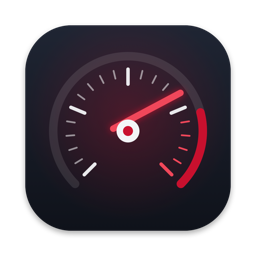
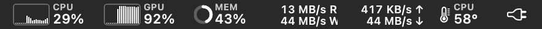
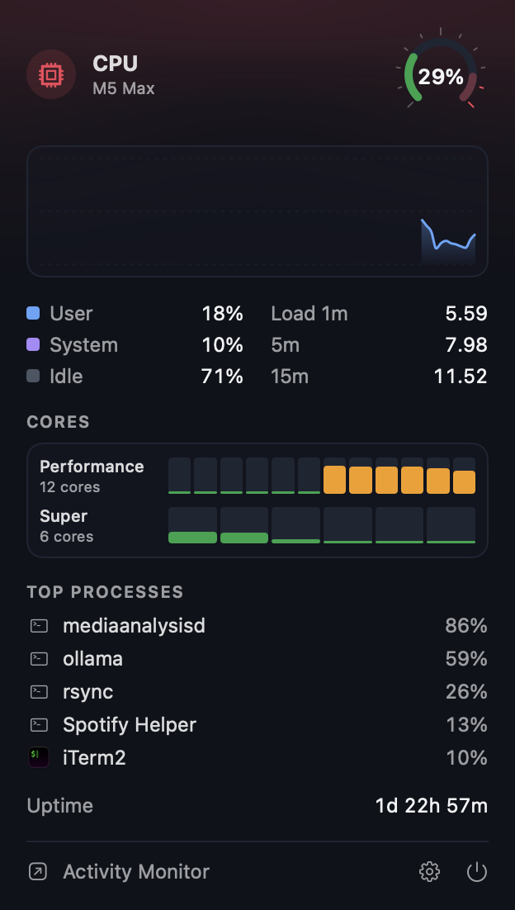
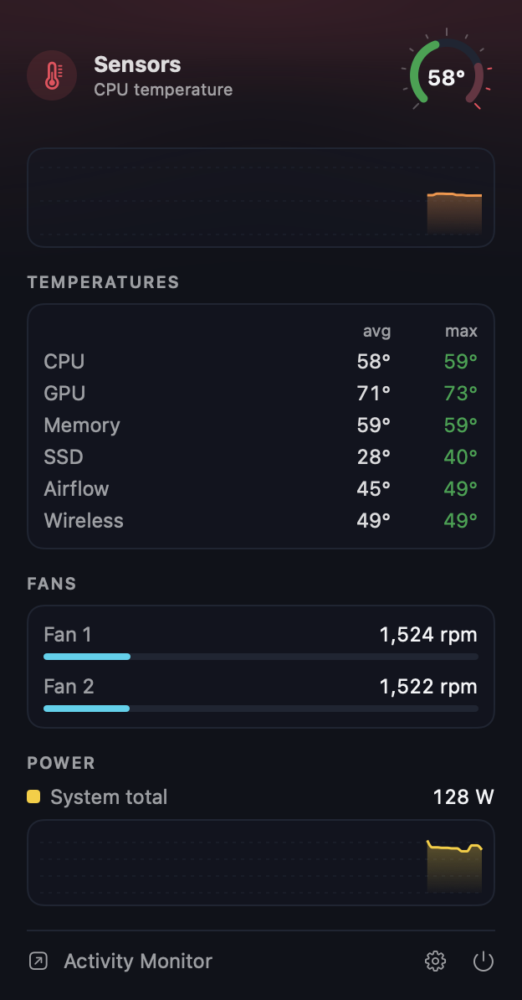
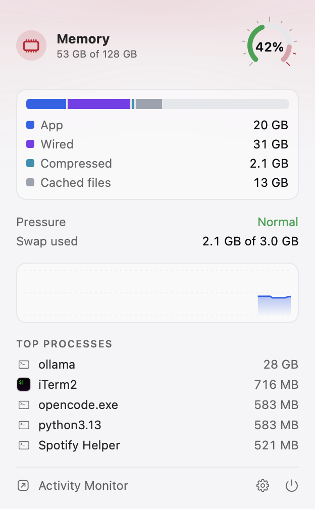

<p align="center">
  
</p>

<h1 align="center">Chrono</h1>

<p align="center">
  <strong>System telemetry for your Mac.</strong><br>
  A free, open-source menu bar monitor for Apple Silicon. Native Swift, no network access, no helpers.
</p>

<p align="center">
  
</p>

<p align="center">
  
  
  
</p>

## What it shows

Each module is its own menu bar item; click one for the full panel.

| Module | Menu bar | Panel |
|---|---|---|
| **CPU** | history graph + load | user / system / idle, load averages, per-core load grouped by cluster, top processes, uptime |
| **GPU** | history graph + load | device and renderer utilization, memory in use, temperature |
| **Memory** | ring + usage | app / wired / compressed / cached breakdown, swap, pressure, top processes |
| **Disk** | read / write | throughput history, capacity of every mounted volume |
| **Network** | up / down | throughput history, peaks, primary interface and local IP, totals since boot |
| **Sensors** | CPU temperature | CPU, GPU, memory, SSD and airflow temperatures, fan speeds, total system power |
| **Battery** | charge | state, time remaining, health (hidden on desktops) |

CPU, Memory, Network and Sensors are on by default. Settings (the gear in any panel) toggles
modules, captions, the update interval, °C/°F, the accent color and launch at login.
⌘-drag menu bar items to reorder them.

## Privacy

Chrono reads everything from local system interfaces and **makes no network connections** —
no analytics, no crash reporting, no update pings. There is no privileged helper and it never
asks for an admin password. The code is small enough to check that claim yourself:
`grep -rn "URLSession\|NWConnection" Sources` comes back empty.

## Install

Download the latest release from [Releases](https://github.com/torresrobert/chrono/releases), unzip,
and move **Chrono.app** to Applications. Requires macOS 14 or later on Apple Silicon.

### Build from source

```sh
git clone https://github.com/torresrobert/chrono && cd chrono
./scripts/bundle.sh --install    # builds Chrono.app, copies it to /Applications and launches it
```

Requires Xcode 16 (Swift 6) or later.

## How it works

Everything is read in-process, without spawning `ps`, `top` or other tools:

| Reading | Source |
|---|---|
| CPU | `host_processor_info` tick deltas; core clusters from `hw.perflevelN.*` |
| Memory | `host_statistics64` (the same accounting as Activity Monitor), `vm.swapusage`, `kern.memorystatus_vm_pressure_level` |
| Processes | `proc_pid_rusage` — sampled only while a CPU or Memory panel is open |
| GPU | IOKit `IOAccelerator` → `PerformanceStatistics` |
| Disk | IOKit `IOBlockStorageDriver` statistics; capacity as Finder reports it |
| Network | 64-bit interface counters from `NET_RT_IFLIST2` |
| Sensors | AppleSMC ([`smc.c`](Sources/CSensors/smc.c)) for temperatures, fans and power; HID sensors ([`hid.c`](Sources/CSensors/hid.c)) as a fallback |

SMC key layouts differ from chip to chip, so Chrono discovers sensors at launch by key prefix
(`Tp`/`Te` CPU, `Tg` GPU, `Tm` memory, `TN` SSD, `TaF`/`TaR` airflow) instead of shipping a
per-model table — new Macs generally work without an update.

Chrono uses about 1–2% of one core at the default 2-second interval.

### Limitations

- Processes owned by other users (root daemons, `WindowServer`) can't be read without root, so
  they don't appear in the top-process lists.
- Temperatures are grouped averages and maxima, not named per-core sensors.
- Apple Silicon only.

## Development

```sh
swift build && swift test
swift run Chrono --dump                              # print every reading once
swift run Chrono --snapshot out/ --scheme dark       # render each panel and the menu bar to PNG
swift run Chrono --selftest out/                     # launch for real, open and capture each panel, quit
swift scripts/make-icon.swift                        # regenerate Resources/AppIcon.icns
```

Issues and pull requests are welcome. Please keep it dependency-free and keep the privacy
promise above intact: changes that add network access won't be merged.

## License

[MIT](LICENSE) © 2026 [Torres Labs LLC](https://torresrobert.com)
